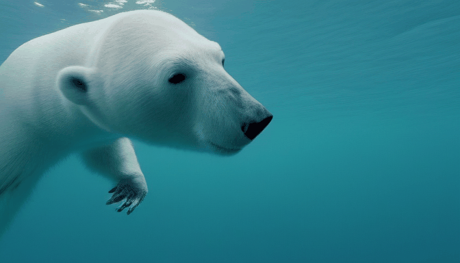

# hotshotco/Hotshot-XL Cog model

This is an implementation of the [hotshotco/Hotshot-XL](https://github.com/hotshotco/hotshot-xl) as a Cog model. [Cog packages machine learning models as standard containers.](https://github.com/replicate/cog)

## Basic usage

Before running the image, you need to fetch the weights:

    cog run python ./scripts/download_weights.py

You can then run the image with:

    cog predict -i prompt="go-pro video of a polar bear diving in the ocean, 8k, HD, dslr, nature footage" -i seed=6226

## Example:

"go-pro video of a polar bear diving in the ocean, 8k, HD, dslr, nature footage"

## License

The code in this repository is licensed under the [Apache License 2.0](LICENSE).

The model weights are not covered by this license. [hotshotco/Hotshot-XL](https://huggingface.co/hotshotco/Hotshot-XL) is released under the [CreativeML Open RAIL++-M](https://huggingface.co/hotshotco/Hotshot-XL/blob/main/LICENSE.md) license. Check its terms before use.
